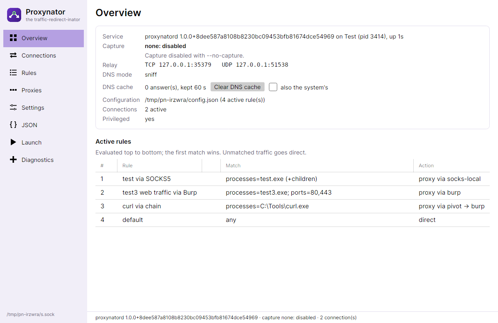
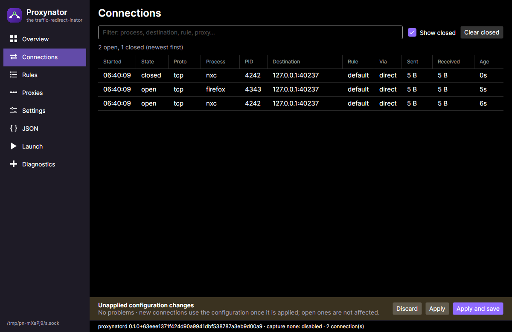
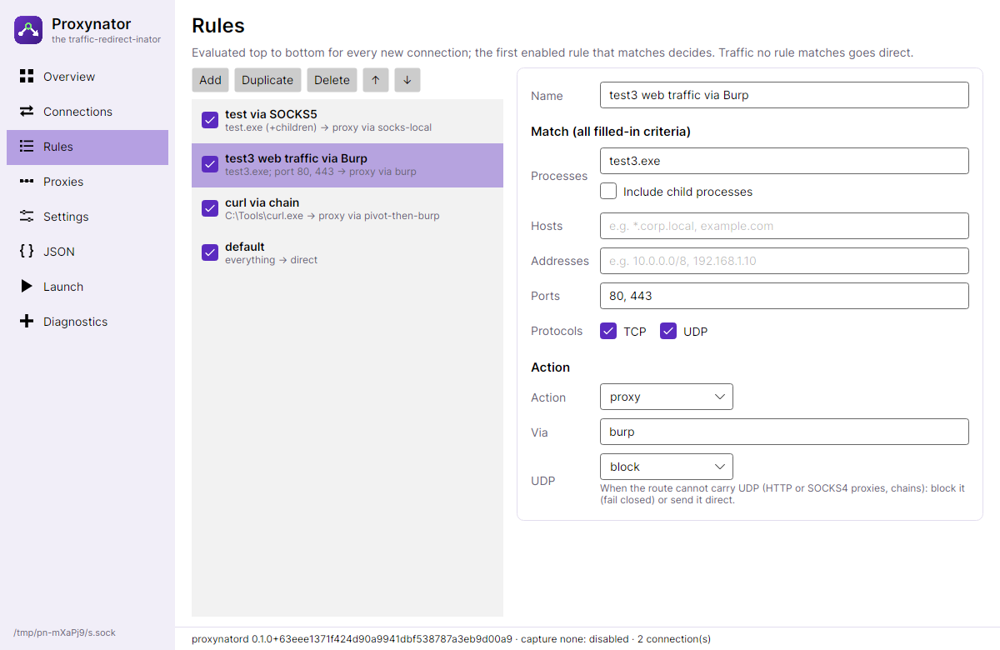
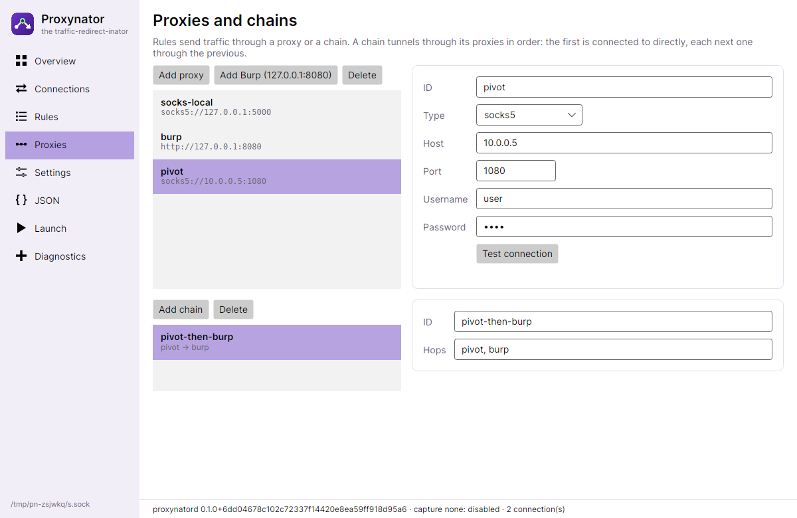
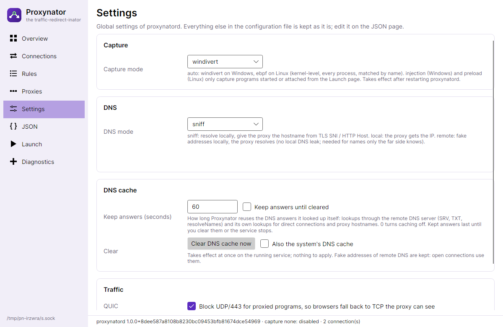
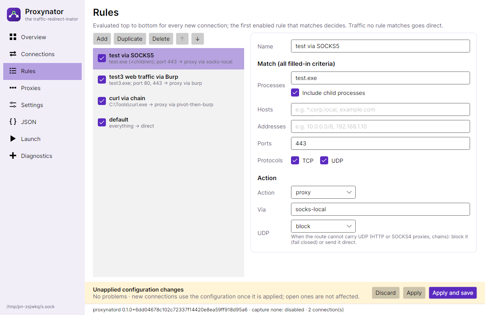
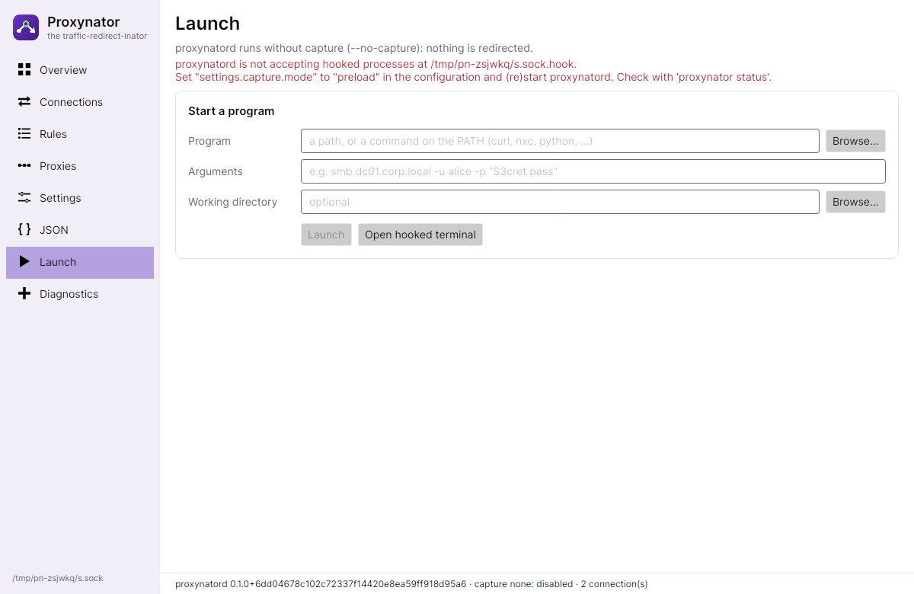
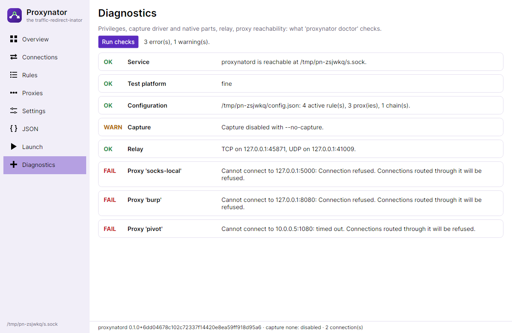

# The GUI

`proxynator-gui` is the control panel for the service. It runs as you (no elevation) and shows the service it talks
to in the bottom-left corner. Everything it does goes through the same API as the CLI, so the two can be mixed. The
theme follows the system (light or dark).

When the service isn't running, a red banner says so. **Start proxynatord** starts it with Administrator / root
rights: the installed Windows service or systemd unit if there is one, otherwise the `proxynatord` next to the GUI.
See [Installation](installation.md).

## Overview

The service and its capture mode, the relay, the DNS mode, the DNS cache (with **Clear DNS cache**), the
configuration file, and the active rules in the order they are evaluated, each with its resolved route
(`proxy via pivot → burp`). If capture **FAILED**, the reason is shown
here and on **Diagnostics**; nothing is redirected in that state.

## Connections

Every connection the relay handles, live and newest first: program and PID, destination (with the hostname when
known), the rule that matched, the route, and bytes in each direction. Closed connections stay listed (up to 1000)
so short-lived ones can still be inspected; **Show closed** and **Clear closed** manage them. The filter matches any
column. Select a row to see the program's full path.

Connections that go direct without passing through the relay (in kernel modes, those no rule could apply to) are not
listed: they were never touched.

## Rules

Rules are evaluated top to bottom for every new connection; the first enabled rule that matches decides. Traffic no
rule matches goes direct.

- **Add** inserts a rule above the selected one (so it isn't hidden behind a catch-all); **Duplicate**, **Delete**,
  **↑** and **↓** do what they say. The checkbox in the list enables or disables a rule.
- **Match**: every filled-in criterion must match; within a field, any entry may match (separate entries with commas).
  - **Processes**: names (`curl.exe`, `nxc`, `python*`) or full paths (`C:\Tools\*`, `*/pipx/venvs/netexec/*`).
    **Include child processes** also matches everything those programs start.
  - **Hosts**: destination names (`*corp.local`, `api.example.com`). A connection's name comes from remote DNS, the
    program's own lookups (hooking modes) or the TLS/HTTP request.
  - **Addresses**: destination addresses and ranges (`10.0.0.0/8`, `192.168.1.10`).
  - **Ports**: `443`, `8000-8100`.
  - **Protocols**: TCP, UDP or both.
- **Action**: `proxy` (through **Via**, a proxy or chain), `direct` or `block`. **UDP** decides what happens to UDP
  traffic a proxy route can't carry: `block` (fail closed) or `direct`.

## Proxies

Proxies have an **ID** (rules refer to it), a **Type** (`socks4`, `socks4a`, `socks5`, `http`), **Host** and **Port**,
and optionally a **Username** and **Password** (SOCKS4 has a user ID only). **Add Burp (127.0.0.1:8080)** adds Burp's
default listener. **Test connection** checks from your machine that the proxy accepts connections (not that it
works end to end; **Diagnostics** and the **Connections** page tell you that).

**Chains** go through several proxies in order: the first is connected to directly, each next one through the
previous ([guide](guides/chains.md)).

## Settings

- **Capture mode**: `auto` (`windivert` on Windows, `ebpf` on Linux) captures machine-wide in the kernel; `injection`
  (Windows) and `preload` (Linux) only capture what you start from **Launch**. Changing it needs a service restart.
- **DNS mode**: `sniff` (default: the proxy gets the hostname from the TLS/HTTP request), `local` (the proxy gets the
  address), `remote` (names in **Remote domains** are resolved by the proxy, on the far side). With remote, **Remote
  DNS server** sends the other lookups for those names (SRV, TXT: domain controller discovery) to a DNS server through
  a proxy, and **Also resolve names with this server** resolves the names there too, for proxies that can't
  ([C2 guide](guides/c2-socks.md)).
- **DNS cache**: how long Proxynator reuses the DNS answers it looked up itself (seconds; `0` = off), or **Keep
  answers until cleared**. **Clear DNS cache now** empties it on the running service at once
  ([details](configuration.md#clearing-the-dns-cache)).
- **QUIC**, sniff and connect timeouts.

Settings the GUI has no field for are kept as they are; edit them on the **JSON** page.

## Applying changes

The **Rules**, **Proxies**, **Settings** and **JSON** pages edit a working copy of the configuration. Problems show up
as you type ("Rule 'web' (action.target): Unknown proxy or chain 'brup'."). Nothing changes on the service until you
press:

- **Apply**: until the service restarts.
- **Apply and save**: also saved as the service's configuration file.
- **Discard**: back to what the service has.

The service checks the configuration again and swaps it in one step: new connections use it, open ones are not
affected. While you have no unapplied changes, changes made elsewhere (the CLI, another GUI) appear automatically.

## JSON

The working copy as configuration JSON: paste a configuration, **Open file…**, **Save as…**, **Validate**. **Use as
working copy** takes the text over into the editors (then apply it as usual). See [Configuration](configuration.md).

## Launch

In the `injection` (Windows) and `preload` (Linux) modes, only programs started (or attached to) through Proxynator
are captured, together with everything they start ([guide](guides/hooking.md)):

- **Launch** starts a program (a path, or a command on the `PATH`) with arguments and a working directory.
- **Open hooked terminal** opens PowerShell (Windows) or your shell in the desktop's terminal (Linux): everything you
  run in it is captured.
- **Attach** (Windows) loads the hook into a running process: its new connections follow the rules.

In the kernel modes there is nothing to launch: start programs as usual, the rules match them by name.

## Diagnostics

The same checks as `proxynator doctor`: privileges, the capture driver or eBPF support, the native parts, the relay,
DNS, and whether every proxy accepts connections. Warnings explain risky combinations, such as remote DNS with a plain
SOCKS4 proxy.
