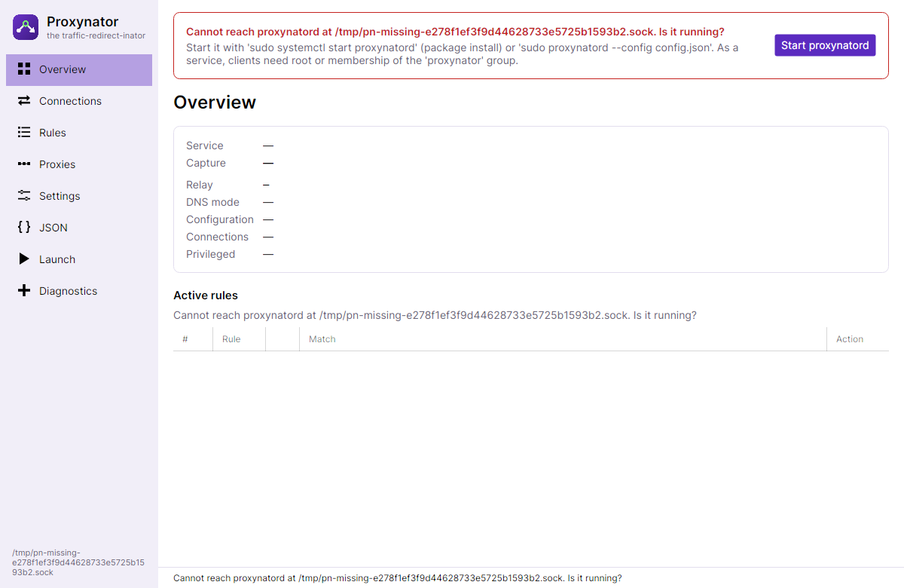

# Installation

Proxynator has three parts, all in every package:

| Program | What it does | Runs as |
|---|---|---|
| `proxynatord` | The service: captures and relays connections. | Administrator (Windows) / root (Linux). It refuses to start otherwise. |
| `proxynator-gui` | The GUI. | You. |
| `proxynator` | The CLI, for scripts and terminals. | You. |

The GUI and CLI only talk to the service (over `\\.\pipe\proxynator.v1` on Windows, `/run/proxynator/proxynator.sock`
on Linux), so they don't need elevation, but whoever can talk to the service can redirect traffic. Access is limited
accordingly (below).

Download from the [latest release](https://github.com/SieBRUM/proxynator/releases/latest). `SHA256SUMS` lists the
checksums of every package.

## Windows 10/11 (x64)

1. Unzip `proxynator-<version>-win-x64.zip`, e.g. to `C:\Tools\Proxynator`.
2. Start `proxynator-gui.exe` and click **Start proxynatord** in the red banner. Confirm the UAC prompt.

   

   The service runs in its own console window. Closing that window (or Ctrl+C in it) stops it, and normal networking
   is restored immediately.
3. The **Diagnostics** page should show no errors.

The configuration is saved to `%ProgramData%\Proxynator\config.json` when you press **Apply and save**. That folder is
readable by Administrators only, because it can hold proxy passwords.

From a terminal instead: `proxynatord.exe` in an elevated PowerShell, then `proxynator.exe status` in a normal one.

### As a Windows service

To have Proxynator running all the time (elevated PowerShell, with the full path):

```
sc.exe create proxynatord binPath= "C:\Tools\Proxynator\proxynatord.exe" start= auto
sc.exe start proxynatord
```

It then runs as LocalSystem, and the GUI and CLI must run **as Administrator** to reach it. **Start proxynatord** in
the GUI starts the installed service. Remove it with `sc.exe stop proxynatord` and `sc.exe delete proxynatord`.

## Ubuntu and Kali (`.deb`, x64 and arm64)

1. Install the package for your architecture (`dpkg --print-architecture` says which):
   ```
   sudo apt install ./proxynator_<version>_amd64.deb
   ```
   It installs to `/opt/proxynator`, puts `proxynator`, `proxynator-gui` and `proxynatord` on the `PATH`, adds a
   systemd unit, a *Proxynator* menu entry, `/etc/proxynator/config.json` and a `proxynator` group. It doesn't start
   anything by itself.
2. Allow yourself to use the GUI and CLI without sudo, then log out and in again:
   ```
   sudo usermod -aG proxynator "$USER"
   ```
3. Open *Proxynator* from the menu and click **Start proxynatord** (it runs `pkexec systemctl start proxynatord`;
   enter your password), or `sudo systemctl enable --now proxynatord` to also start it at boot.

The configuration lives in `/etc/proxynator/config.json` (mode 0640, it can hold proxy passwords). Logs:
`journalctl -u proxynatord`. Requirements: Ubuntu 22.04 or newer, or Kali rolling (other systemd distributions with
kernel BTF and `libbpf` are likely fine). The GUI needs an X11 or XWayland desktop.

## Other Linux distributions (`.tar.gz`)

```
sudo tar -xzf proxynator-<version>-linux-x64.tar.gz -C /opt
sudo mv /opt/proxynator-<version>-linux-x64 /opt/proxynator
sudo groupadd --system proxynator && sudo usermod -aG proxynator "$USER"   # then log out and in
```

- Start it with **Start proxynatord** in `/opt/proxynator/proxynator-gui` (uses `pkexec`), or `sudo
  /opt/proxynator/proxynatord`.
- To run it at boot, install `packaging/proxynatord.service` into `/etc/systemd/system/`. It expects
  `/opt/proxynator` and `/etc/proxynator/config.json`. `packaging/` also has the desktop entry and icon.
- Without the `proxynator` group only root can talk to the service.

The `ebpf` mode needs cgroup v2, kernel BTF and the system's `libbpf` (`libbpf1`, or `libbpf0` on older systems).
**Diagnostics** checks all of it.

## Updating and removing

- **Windows:** stop the service, replace the folder. Your configuration stays in `%ProgramData%\Proxynator`.
- **`.deb`:** install the new package over the old one. `sudo apt remove proxynator` removes it and keeps
  `/etc/proxynator`; `apt purge` removes that too.

Stopping or uninstalling never leaves networking broken: the WinDivert handle closes and the eBPF programs detach when
the service exits, even when it crashes.
